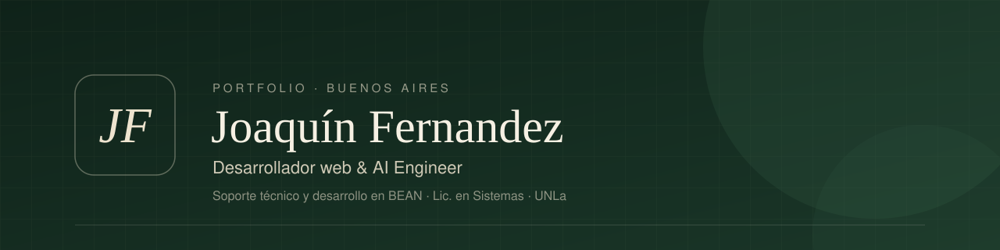

  

  
  

### Hola, soy Joaquín 👋

Desarrollador web autodidacta y **AI Engineer** de Buenos Aires. Trabajo en **[BEAN](https://bean.com.ar)** en soporte técnico y desarrollo, con un foco cada vez mayor en **inteligencia artificial aplicada**: integrar modelos y automatizaciones en procesos reales para que funcionen mejor.

En paralelo curso la **Licenciatura en Sistemas** en la Universidad Nacional de Lanús (UNLa) y sigo aprendiendo por mi cuenta.

> *Me interesa crear productos digitales claros y bien construidos, que resuelvan necesidades reales.*

- 🌱 Ahora mismo: IA aplicada a procesos de negocio, React y TypeScript
- 🧭 Abierto a oportunidades laborales, colaboraciones y proyectos
- 📫 La forma más rápida de contactarme: [joaquinfernandezds@gmail.com](mailto:joaquinfernandezds@gmail.com)

---

### Proyectos

| | Proyecto | Qué es | Stack |
|---|---|---|---|
| 🟢 | **[JM Gestión Documental](https://github.com/Joa6jb/JM.GestionDocumental)** · [ver sitio](https://jmgestiondocumental.com.ar) | Sitio en producción para una gestoría de ciudadanía española, apostillado y traducciones. Catálogo de trámites, formulario validado, FAQ, SEO y diseño mobile first. | React 19 · TypeScript · Tailwind 4 · Vite · Firebase |
| 🧑‍💻 | **[Portfolio](https://github.com/Joa6jb/portfolio)** · [ver sitio](https://joaquinfernandez-dev.web.app) | Mi portfolio personal, hecho a mano sin frameworks y con deploy automático. | HTML · CSS · JavaScript · GitHub Actions · Firebase |
| 🎵 | **[Bot de música para Discord](https://github.com/Joa6jb/BotMusicaDiscord)** | Bot con comandos slash para reproducir música en canales de voz: play, cola, skip, stop y "sonando ahora". | Node.js · discord.js · DisTube |
| 🐶 | **[Sistema de adopción de perros](https://github.com/Joa6jb/IFTS11-POO-2025-GRUPAL)** | Trabajo grupal de Programación Orientada a Objetos (IFTS 11): sistema web para gestionar adopciones. | Python · Django · SQLite |

---

### Herramientas

**Desarrollo web**

  
  
  
  
  
  
  
  
  
  

**Inteligencia artificial**

  
  
  
  
  

**Deploy y trabajo diario**

  
  
  
  
  

---

  Buenos Aires, Argentina · Este perfil crece a medida que publico nuevos proyectos.

